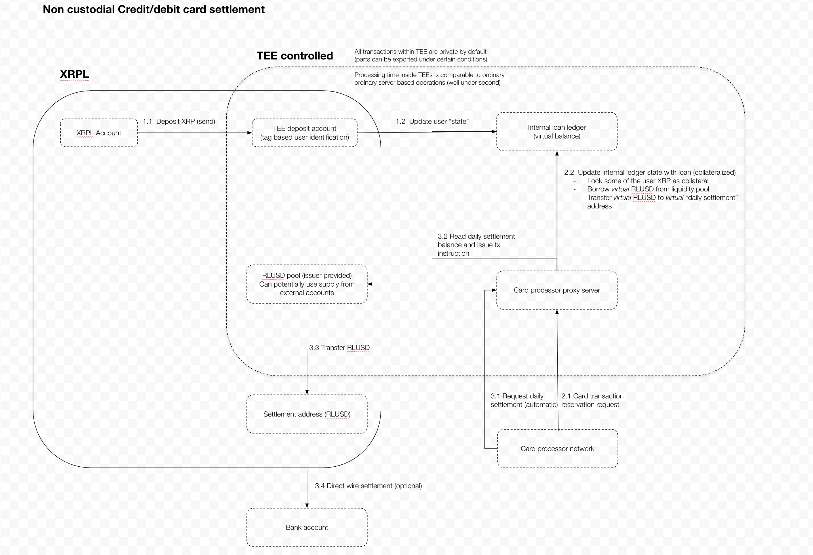
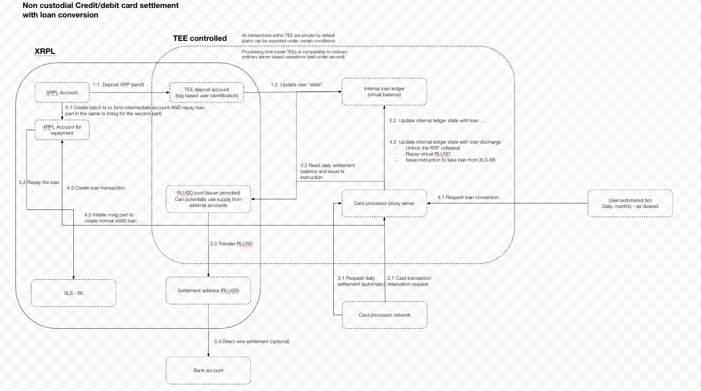

# XRPL-Credit-Card

This project is a simple implementation of a credit card system on the XRPL ledger using Flare Confidential Extensions (FCE) to process individual credit card payments.

The whole monthly workflow takes place inside FCE to allow for fully confidential processing of the credit card payments and fast enough response times for the credit card network to approve or decline the transaction.
The server inside FCE is called the *CREDIT SERVER* and it is responsible for processing the credit card payments, checking the user's position, and settling the payments with the merchants.

Inside the Credit Server, the lending protocol proceeds as a virtual ledger of an overcollateralized loan system.
Users deposit their XRP as collateral at the start of the process (they are free to withdraw it at any time, but they will be unable to make payments if they do so, they are also free to increase the collateral at any time to increase their monthly credit limit).
Since credit limits inside the FCE are based on the amount of collateral deposited, there is no need for a traditional credit check and processing.

Upon user making a payment with their credit card, payment processing network sends the approval requests to the Credit Server which checks the user's position and borrows the required amount of RLUSD from the virtual ledger to approve the transaction. 
The Credit Server then settles the payment with the merchant and updates the user's position in the virtual ledger.
Credit Server keeps track of all the payments and settles the daily with the card issuer system directly on the XRPL using RLUSD.

Moving the whole credit card processing inside FCE allows for a fully confidential processing of individual payments (disclosing neither the time nor the amount of individual payments) while still allowing for a regular settlement with the card issuer on chain.
Since the Credit Server settles much faster than the ledger itself (typically within a hundred milliseconds), the credit card network can approve or decline the transaction in a timely manner (well under the realistic 1-second limit for credit card processing).

User can easily see their positions, loan status and all the necessary statistics on the associated fronted.

On a regular basis, user can request to settle their cash position with the Credit Server and either pay them off in full or partially or automatically convert them to an XLS-66 based loan on the XRPL to free the collateral and move to a traditional loan system with a regular repayment schedule and interest rate.
The credit conversion is public and has to first be approved by the loan broker.
The conversion and the repayments are automated by the Credit Server (see below).

## Loan conversion specifics

**The TEE never confirms a conversion.**
It only reserves the debt (`CONVERT_REQUEST`) and later sees RLUSD repaid to the pool under the user's destination tag (`CREDIT_RLUSD_REPAYMENT`), which lowers the debt and unlocks the matching share of XRP collateral.
If that repayment never arrives, the loan was not converted: the reservation lapses after 15 minutes and nothing changed.
From the TEE's point of view, conversion is just one way to start repaying; the resulting loan is entirely between the user and the loan broker on XRPL.
Any tagged RLUSD payment to the pool repays debt the same way, so a user can also pay off directly.

The Credit Server (the watcher, for the demo) runs the conversion:

1. **Reserve.** TEE `CONVERT_REQUEST {tag, rlusdAmount}` checks the amount against the debt not already reserved and names the exact loan to take: broker, terms, pool and tag.
2. **Repayment account.** Each user has one XRPL account, a 1-of-2 multisig of the user's key and the Credit Server's key, with its own master key disabled. It is created on the first conversion and reused for every later one; each conversion is just another loan on it.
3. **Broker approval.** The mock loan broker, a separate wallet standing in for an outside party, countersigns the `LoanSet` only when it matches an open TEE conversion for that user's repayment account with the standard terms.
4. **Take the loan and repay the TEE.** The Credit Server signs, as the repayment account, the `LoanSet` (principal from the vault into the account) and immediately a Payment of exactly the principal to the pool with the user's tag. The user signs nothing here and cannot add anything to it.
5. **Credit.** The watcher sees the tagged RLUSD arrive at the pool and calls `CREDIT_RLUSD_REPAYMENT`.

**Repaying the loan** is a user-side XRPL matter. The user sends RLUSD from Xaman to their repayment account, then the Credit Server signs `LoanPay` for exactly the delivered amount on one of that account's loans (`POST /loans/pay`). The TEE is not involved.

### Repayment accounts: how the multisig works

Each user's loans live on one **repayment account**, an XRPL account controlled by two keys instead of its own (`watcher/src/lending.js`).

**Setup.** On the user's first conversion the Credit Server creates it in four ordinary transactions (`createRepaymentAccount`):

1. The pool funds it with 5 XRP for its reserves (and tops it up when a new loan's reserve would leave too little, `ensureSpendableXrp`).
2. A `TrustSet` for RLUSD, with NoRipple.
3. A `SignerListSet` with **quorum 1** and two signers of weight 1: the user's address and the Credit Server's.
4. An `AccountSet` that **disables the master key**. The account's own seed is thrown away, so from then on only the two signers can act for it.

Before reusing an account for a later conversion, `isRepaymentAccountFor` checks on chain that the master key is still disabled and the signer list is exactly those two addresses with quorum 1.

**Why quorum 1 with two signers.** Either key alone authorizes any transaction from the account.

- The **Credit Server** can run the loan without the user signing anything: it takes the loan and pays each installment.
- The **user** keeps an exit: if the Credit Server disappears or misbehaves, the user can sign `LoanPay` themselves, or move the RLUSD, with their own key. The Credit Server can never lock their funds in.
- The cost is that the user can also move borrowed RLUSD in the moment between `LoanSet` and the repayment to the pool (see Current Limits, "Taking the loan is not atomic on Devnet").

**Signing as the account.** The Credit Server autofills the transaction with the repayment account as `Account`, sized for one multisigner, and signs it as a multisigner with its own key (`signAsRepaymentAccount`). The result is a normal multisigned transaction whose `Signers` holds the Credit Server's signature; with quorum 1 that is enough.

**What the Credit Server signs as a repayment account**, and only these:

- **The agreed `LoanSet`.** It matches the TEE's open conversion, with the standard terms and the loan broker's `CounterpartySignature` (`broker.js` checks the conversion before countersigning).
- **The repayment to the pool.** An RLUSD Payment of exactly the loan's principal to the pool, with the user's destination tag, so the TEE credits it as a repayment of card debt.
- **`LoanPay` for what the user funded** (`payLoan`, `POST /loans/pay`). The Credit Server first checks the funding payment:
  - it is a validated, successful Payment;
  - it goes from the user to their own repayment account;
  - it delivered RLUSD (per `delivered_amount`);
  - the loan belongs to that account;
  - the payment has not funded a `LoanPay` before (`loan-payments.json`).

  It then signs `LoanPay` for exactly the delivered amount. Installments only ever spend what the user put in.

Today the Credit Server's key is held by the watcher (Current Limits). In production it becomes a wallet key inside the TEE, and those rules become checks in the extension's code before it signs ([amazon.md](amazon.md)).

The lending side (vault, loan broker, first-loss cover, broker and Credit Server wallets) is set up once per network with `cd watcher && node src/setup-lending.js`, then `node ../scripts/sync-config.mjs`.
The vault is closed-ended, as `LendingProtocolV1_1` requires: all liquidity is deposited before its subscription date, and loans must finish before its redemption date (5 years out).

On Devnet today, steps 4 and the repayment are **two transactions each**, not Batches: `LoanSet` and `LoanPay` cannot be Batch inner transactions until the `LendingProtocolV1_2` amendment, which Devnet does not have yet. After it, step 4 becomes one all-or-nothing Batch, with the broker signing as a `BatchSigner`.

See [Lending protocol versions and the underwriting model](#lending-protocol-versions-and-the-underwriting-model) for why the vault looks the way it does and what that means for running this with a real lender.

# The TEE lending pool and liquidity providers

Card spending is funded by **one lending pool inside the TEE**.
The operator's own liquidity and third-party liquidity providers' (LPs') liquidity are mixed in it; both hold the same pool shares and are treated identically, the same way a Morpho or Aave vault treats its suppliers.
(This pool is separate from the XLS-66 vault that converted loans are drawn from, which lives on XRPL; see below. An XRPL Single Asset Vault could not be this pool: its assets can only go out as XLS-66 loans with fixed schedules, while card debt is drawn per swipe and accrues by the minute. See [docs-feedback.md](docs-feedback.md).)

**Borrowers pay, LPs and the TEE earn.**

- Card debt accrues a **fixed 12% a year**, from the moment of each card payment, in one-minute steps (`BorrowAPRBps`, `InterestAccrualPeriod` in `extension/pkg/card/config.go`).
- **10% of that interest** (the reserve factor) and a **1% merchant fee** on every card payment go to the TEE: the merchant is paid 99% at settlement. That profit is paid out to a separate XRPL **treasury account** with each daily settlement.
- The other 90% of the interest stays in the pool and raises the share price. The supply rate LPs see is `12% × utilization × 90%`.

**What a share is worth.**
`totalAssets = pool cash + card debt (with interest) − card spend not yet paid to merchants − profit not yet paid to the treasury`.
Deposits and withdrawals use the ERC-4626 formulas (`shares = amount × totalShares / totalAssets`, and back), so interest shows up as a rising share price rather than a separate claim.

**Shares are a trust-line token on XRPL** (currency `XCLP`), issued by the **LP deposit account**; one share starts at one RLUSD, and shares are transferable (the issuer has DefaultRipple; its own RLUSD trust line is NoRipple, so RLUSD never routes through it).
The TEE only tracks the total, in integer units of 1e-6 share; the watcher converts to and from the token's decimal amounts. Who holds shares is XRPL's business, and whoever sends shares back is paid.

> **Why a trust-line token and not an MPT:** compatibility. An MPT (XLS-33) would be the more natural fit (integer amounts, no rippling to manage), and the first version used one, but wallet and explorer support for MPTs is still uneven, while trust-line tokens work everywhere, including Xaman. The TEE side is the same either way; only the watcher's issuing and the opt-in transaction differ.

**Flows** (the TEE decides, the watcher executes on XRPL):

| LP does | XRPL | TEE | Watcher then |
|---|---|---|---|
| Reserve a tag (Yield or Liquidity page) | — | `LP_REGISTER` gives an LP tag (500001 and up) | — |
| Opt in to shares, once | `TrustSet` to the LP deposit account for `XCLP` | — | — |
| Deposit | RLUSD → LP deposit account with the LP tag | `LP_DEPOSIT` mints shares | sends the shares, sweeps the RLUSD into the main pool |
| Withdraw | shares → LP deposit account (burned) | `LP_REDEEM` names the RLUSD payout | pays it from the pool; if the TEE reverted, sends the shares back |

LPs use the web app's **Liquidity provider** app. Its **Next round** tab lets an LP mark part of its deposit for the next round's uncollateralized lending protocol (riskier, higher APY) with a slider; that choice is saved off chain only (see Current Limits). Its Yield page shows the APY (the supply APR compounded every minute, as the pool accrues) and walks through the three transactions above with a **Ledger** hardware wallet or Xaman. The Ledger works on every page that signs: once an address is connected through a Ledger, its collateral deposits, loan installments, trust lines, LP deposits and withdrawals are all confirmed on the device. For a Ledger, the browser has no XRPL connection, so the watcher fills in and encodes each transaction (`POST /hw/prepare`), the device signs exactly those bytes, and the watcher submits them (`POST /hw/submit`). The key never leaves the device, and a transaction changed in between would not match its signature.

`GET_VAULT` reports the pool (and one LP's records), and `GET_STATS` includes it with liquidity split into **internal** (the operator's shares) and **LP**.

**Liquidity never runs short in the demo.**
The operator adds liquidity whenever needed with an **operator deposit** (the Operator app's Settlement page button, or `POST /operator/deposit` on the watcher): the mock RLUSD issuer mints into the LP deposit account under the operator's LP tag, so it goes through the normal deposit path and the operator gets shares.
A card payment or withdrawal that would need more free cash than the pool has simply reverts (`insufficient pool liquidity`); there is no queue and no utilization-driven rate.

Setup: `cd watcher && npm run setup-vault` (treasury, LP deposit and operator accounts, the XCLP share token, share trust lines for the operator and demo user), then `node ../scripts/sync-config.mjs`.

# Collateral beyond XRP: any token, and RWA

The demo takes XRP as collateral, but nothing in the design depends on XRP.
The collateral asset can be **any XRPL token**: a trust-line token (issued currency) or an MPT.
The TEE does not care what it holds; it needs a deposit it can attribute (a destination tag), a price, and risk parameters for that asset.

The most interesting case is **RWA (real-world assets) as collateral**: tokenized treasuries and money-market funds, tokenized deposits and stablecoins, commodities, credit and real-estate tokens.
XRPL is already strong in RWA, with a lot of tokenized capital and TVL issued on it, and a card that lets holders spend against those positions without selling them puts that capital to work.
RWA also allow a **much better risk model** than a volatile crypto asset:

- **Per-asset LTV and haircuts.** A short-duration treasury token can safely carry a far higher LTV than XRP's 75%, with a haircut sized to its price volatility, duration and redemption terms.
- **Better prices.** NAV published by the issuer or fund administrator, XRPL Price Oracles (XLS-47) or Flare's FTSO feeds, with staleness limits per asset. The TEE can combine and check several sources without revealing positions.
- **Issuer and compliance risk is visible on chain.** Freeze and clawback flags, permissioned domains and credentials (XLS-80 / XLS-70) tell the risk model who controls the asset and who may hold it; the TEE can price those in, or only accept assets whose holders pass the issuer's checks.
- **Portfolio limits.** Concentration limits per issuer and asset class, and correlation-aware limits across a cardholder's collateral.
- **Confidential by design.** Positions, the risk model's inputs and every card payment stay inside the TEE, which matters for the institutional and private holders RWA attract.

What would change in this repository:

- **Watcher** (`watcher/src/index.js`): accept tagged deposits of allow-listed assets, not only XRP. A trust-line token arrives as `{currency, issuer, value}` and an MPT as `{mpt_issuance_id, value}` in `delivered_amount` (never `Amount`), as the RLUSD and share-token paths already handle.
- **Ledger** (`extension/pkg/card`): collateral balances per asset instead of `XrpAvailable` / `XrpLocked`, a price per asset, and per-asset risk parameters (LTV, haircut, concentration limit) in place of the single `LTVCapBps`. The card payment check becomes `debt ≤ Σ value_i × LTV_i`, and repayments unlock collateral per asset.
- **Holding the collateral.** The deposit account needs a trust line (or MPT opt-in) per accepted asset, and RWA issuers often require authorization (`RequireAuth`, credentials) before an account can hold their tokens.

None of this is implemented; the demo stays XRP-only.

# Lending protocol versions and the underwriting model

Loan conversion sits on the XRPL Lending Protocol (XLS-66) and Single Asset Vaults (XLS-65).
Both are still changing between amendments, and two of those changes shape this design directly.
This section explains what each one does, what we observed on Devnet, and how the demo maps onto the way a card issuer and its bank would actually run it.

## The three pieces on chain

- **Vault (XLS-65).** Holds the loanable RLUSD. Depositors put RLUSD in and receive vault shares; loans are paid out of the vault's available assets, and repayments (principal plus interest) flow back into it.
- **Loan broker.** Created with `LoanBrokerSet` on top of exactly one vault, by that vault's owner. It originates loans from the vault, countersigns every `LoanSet`, and holds the **first-loss cover** (`LoanBrokerCoverDeposit`): its own capital that absorbs defaults before the vault's depositors lose anything.
- **Loan.** Created by `LoanSet`, signed by the borrower and countersigned by the broker. It fixes the principal, interest rate, number of payments, payment interval and grace period. The borrower repays with `LoanPay`.

In the demo, one mock broker wallet owns the vault, the loan broker and the cover; `watcher/src/setup-lending.js` creates all three.

## `LendingProtocolV1_1`: closed-ended vaults (enabled on Devnet)

The original `LendingProtocol` used open-ended vaults: anyone could deposit or withdraw at any time, and a broker could lend from the vault indefinitely.
`LendingProtocolV1_1` changes that at the point where a vault is bound to lending: **`LoanBrokerSet` refuses any vault that is not closed-ended** (it fails with `tecNO_PERMISSION`, which is exactly what our first setup attempt hit).

A closed-ended vault is created with `VaultKind: 1` plus two dates, and lives through three phases:

| Phase | When | Deposits | New loans |
|---|---|---|---|
| Subscription | before `SubscriptionDate` | allowed | refused (`tecTOO_SOON`) |
| Investment | between the two dates | refused (`tecEXPIRED`) | allowed, if the loan ends in time |
| Redemption | after `RedemptionDate` | refused | refused (`tecEXPIRED`) |

Two more rules come with it:

- **Every loan must finish before the vault's redemption date.** `LoanSet` is refused unless the loan's start date plus `PaymentTotal × PaymentInterval`, plus a 60-second buffer, is no later than `RedemptionDate`. A 12-month loan cannot be issued in the last 12 months of a vault's life.
- **The investment period is bounded.** `RedemptionDate − SubscriptionDate` must be at least 180 seconds and under 30 years.

In practice this turns a vault into a **fund with a fixed size and a fixed life**: investors subscribe up front, the money is lent out for a known period, and at the end the vault winds down.
That is a good fit for how lending is actually funded, but it has consequences:

- **Liquidity is fixed once loans start.** Nothing can be deposited after `SubscriptionDate`. Repaid principal and interest come back into the same vault and can be lent again, but the vault never grows. Our demo vault holds 500,000 RLUSD for that reason; it cannot be topped up.
- **Loans can only start after the subscription window.** `setup-lending.js` uses a 5-minute window, so a freshly set-up vault cannot lend for 5 minutes.
- **A vault stops being usable for new loans well before it ends.** With our standard 12 × 30-day terms, the last conversion a vault can take is about 360 days before its `RedemptionDate`. The demo vault runs for 5 years, so it can originate loans for roughly the first 4.

## `LendingProtocolV1_2`: lending inside Batch (not on Devnet yet)

Before `LendingProtocolV1_2`, rippled refuses every vault and lending transaction as an inner transaction of a Batch (XLS-56).
That list covers `VaultCreate`, `VaultSet`, `VaultDelete`, `VaultDeposit`, `VaultWithdraw` and `VaultClawback`, plus `LoanBrokerSet`, `LoanBrokerDelete`, the three `LoanBrokerCover…` transactions, `LoanSet`, `LoanDelete`, `LoanManage` and `LoanPay`.
Any of them inside a Batch fails with `temINVALID_INNER_BATCH`, which is what we saw on Devnet.
`LendingProtocolV1_2` lifts that restriction: these transactions then go through the normal Batch checks.

It also changes how the broker approves a loan inside a Batch.
An inner transaction may not carry a signature, so the broker cannot put its `CounterpartySignature` into an inner `LoanSet`.
Instead, the inner `LoanSet` names the broker in its `Counterparty` field, and the broker signs the whole Batch as a `BatchSigner`, the same way any other second account in a Batch does.

What this means for us once Devnet has it:

- **Taking the loan becomes atomic.** Step 4 of the conversion becomes one all-or-nothing Batch: `LoanSet` plus the tagged Payment of exactly the principal to the pool. Either both happen or neither does, so borrowed RLUSD never sits in the repayment account where the user could move it. Today it is two transactions, and the watcher sends the second immediately after the first and can retry it.
- **Repaying becomes atomic too.** The user's RLUSD Payment to the repayment account and the `LoanPay` from it can go in one Batch. The Credit Server signs as the repayment account's `BatchSigner`, and the user signs the outer transaction in Xaman.
- **Repayment-account setup could become one Batch,** if the Batch issue we hit with `SignerListSet` and disabling the master key turns out to be something else. Setup is safe to retry, so this matters least.

The details above come from rippled's `develop` branch (`Batch.cpp`, `LoanSet.cpp`, `VaultCreate.cpp`) as of this writing.
Amendments can still change before they are enabled, so re-check against the rippled version the target network actually runs before relying on them.
This is also why our broker signature uses the `CPT` signing prefix (`CounterpartyTxSign`), which the current xrpl.js helper does not.

## Who provides the money: the underwriting bank

> **This is an example, not a prescribed structure.**
> How loans are funded, who underwrites them, how vaults are sized, split and rolled over, and which terms are offered are decisions for the credit card issuer and its partners.
> The protocol only constrains the shape (closed-ended vaults, one vault per loan broker, loans that end before redemption); everything below is one plausible way to fit a card programme into it, and the demo implements only the simplest version: one vault, one broker.

In the demo, the mock broker both lends the money (it is the only vault depositor) and approves the loans.
One natural real-world setup looks much like a normal credit card programme, where a bank underwrites the card:

- **The bank underwrites the loans.** It runs the loan broker, sets the terms, and decides which conversions it accepts. In XLS-66 terms it signs every `LoanSet` as the broker.
- **The bank provides most of the liquidity.** It is the main depositor in each vault, possibly next to other investors who subscribe alongside it.
- **The bank puts up the first-loss cover.** Its own capital takes the first hit if converted loans default. This matters because a converted loan is unsecured on chain: converting is exactly what frees the user's XRP collateral.
- **The Credit Server (TEE) does not lend.** It reserves card debt, arranges the conversion, and sees the debt repaid to the pool. It never holds the vault's money or decides credit risk.

## Rolling over to a new vault

A closed-ended vault cannot be refilled, so a bank serving conversions continuously needs a **series of vaults**.
In this example, each vault is one funding round; when the current one can no longer take a conversion, the bank opens the next and new conversions move to it.
An issuer could just as well run several vaults in parallel (per region, per risk tier, per funding partner), use different terms per vault, or size and time them differently; the conversion flow only needs to know which broker to use for the next loan.

A vault needs replacing when either of these becomes true:

- **It is running out of liquidity.** Its available assets fall below a threshold, for example the largest conversion the programme allows. Repayments refill it over time, but only from loans it already made.
- **It is running out of time.** `now + PaymentTotal × PaymentInterval + 60 s` passes its `RedemptionDate`, so a standard loan would no longer finish in time.

Because new loans can only start after a vault's subscription window, the next vault has to be created **before** the current one runs dry:

1. The bank creates the next closed-ended vault and deposits into it during its subscription window, then creates the loan broker and deposits the first-loss cover. This is what `setup-lending.js` does today, once.
2. Until the new vault reaches its investment phase, conversions keep using the current one.
3. From then on, **new conversions go to the new loan broker.** The broker id and terms in `CONVERT_REQUEST`'s answer change; nothing else in the flow does.
4. **Existing loans stay where they are.** Each loan belongs to the vault it was drawn from, and every `LoanPay` goes back to that vault. A user's single repayment account can hold loans from several vaults at once, and the Loans page shows them all.
5. Once all its loans are repaid (or written off against the cover) and its redemption date has passed, the old vault winds down and the bank withdraws.

## What the demo does today, and what rollover would need

The demo has exactly **one** vault and loan broker.
Supporting the rollover example above (or any other issuer-defined structure with more than one vault) needs changes in three places:

- **The TEE's broker setting is compiled in.** `DefaultLoanBrokerID` and the loan terms are generated into `extension/pkg/card/defaults_gen.go`, so the image would have to change for each new vault. The TEE should instead keep a list of approved brokers that the operator can update (or that the bank signs), and return the current one from `CONVERT_REQUEST`.
- **The lending setup assumes one vault.** `wallets.json` holds a single `lending` block, and `setup-lending.js` refuses to run twice without `--force`, which replaces it. It would need to append vaults, record each one's dates and size, and mark which one is current.
- **Conversion needs to pick a vault.** The Credit Server (`convert.js`) should check the current vault's available assets and remaining time before `LoanSet`, move to the next vault when either runs low, and warn the bank early enough to open the next vault in time. The mock broker would approve loans against any of the bank's active brokers.

Repayment, the Loans page and the repayment accounts already work across several vaults, because they go by `LoanID` and do not care which vault a loan came from.

# Running it

[demo-playbook.md](demo-playbook.md) sets up a fresh local instance (Devnet wallets, lending, mock TEE, watcher, web) and walks through the full demo, with a check after every step.

# Technical Details

- [pitch.md](pitch.md) is the pitch in a few lines: the three moments to show and what to say.
- [docs-feedback.md](docs-feedback.md) collects what we ran into with XRPL, its amendments, Devnet, xrpl.js, Xaman, Ledger and FCC, and what worked well.
- [amazon.md](amazon.md) explains why the TEE is the core of the design, and makes the case for running the Credit Server on AWS SEV-SNP instances as an FCC platform beside Google Cloud's Confidential Space.
- FCE (huge part) uses the https://github.com/flare-foundation/fce-extension-scaffold with some additional updates for both this hackathon and updates to the scaffold itself found during the development (should also come out as an update to the scaffold itself)

# Configuration

Addresses and deployment ids have exactly three sources of truth, and nothing else should hard-code them:

| Source | Written by | Holds |
|---|---|---|
| `watcher/wallets.json` | `cd watcher && npm run fund-wallets`, `setup-lending`, `setup-vault` | XRPL network, mock RLUSD issuer, all demo wallets, the XLS-66 vault and broker, the LP share token |
| `extension/template/deployments/coston2.json` | `fce deploy`, `fce add-version` | InstructionSender, extension id, deployer, FlareTeeManager, version |
| fce run stack (`<user cache>/fce/run/coston2-template-*`) | `fce run` | machine ids, tunnel URL, local proxy port, direct-action API key |

`node scripts/sync-config.mjs` reads them and writes every derived copy:

- `extension/pkg/card/defaults_gen.go`: the TEE's default deposit and settlement accounts (also `go generate ./pkg/card` from `extension/`)
- `web/lib/deployment.gen.json`: what the web app shows (`web/lib/fcc.ts`)
- `watcher/.env` and `web/.env.local`: only the keys it owns; everything else in those files is kept

It runs automatically before `npm start` / `npm run settle` in `watcher/`, before `pnpm dev` / `pnpm build` in `web/`, and in `scripts/export-wallets-env.sh` and `scripts/run-watcher-fcc.sh`.
After `fce deploy`, `fce add-version` or `fce run`, just restart the watcher and the web app.
`node scripts/sync-config.mjs --check` exits non-zero when anything is out of date, which is useful before a demo or in CI.

The TEE's default accounts are compiled into the image, so changing `wallets.json` changes the code hash.
When the script says so, refresh the conformance fixtures (`cd extension && go test ./template/internal/app -update`), rebuild the image and `fce add-version`.
`fce run` does not pass extension env vars into the TEE, which is why the defaults have to be baked in rather than set through `XRPL_DEPOSIT_ACCOUNT`.

## Network

Every XRPL transaction the app submits, from the watcher, the setup scripts and the web app's Xaman or Ledger signing, carries **`SourceTag` 2610250019**, so the app's activity can be found on the ledger. It is set once, as `xrplSourceTag` in `app.config.json`; `sync-config` copies it to `watcher/.env` and the web app. The watcher adds it as xrpl.js autofills each transaction (`watcher/src/source-tag.js`). Transactions users sign get it forced at the two points they pass through: the web's Xaman payload route (`web/app/api/xaman/create-payload`) and the watcher's Ledger relay.

The demo runs on **XRPL Devnet**, because the Lending Protocol (XLS-66) and Single Asset Vaults that loan conversion needs are enabled there but not on Testnet.
Devnet has no real RLUSD, so `fund-wallets` creates a mock RLUSD issuer, sets up trust lines and mints demo supply to the pool and the demo user.
Add pool liquidity with an operator deposit (the "Deposit 10,000 RLUSD" button on the Operator app's Settlement page, or `POST /operator/deposit` on the watcher), which goes through the LP path so the TEE accounts for it; `cd watcher && npm run mint-rlusd -- <address> <amount>` mints demo RLUSD to any other account.

To switch networks, run `npm run fund-wallets -- testnet` (or `devnet`) in `watcher/` with the old `wallets.json` moved away, then `node scripts/sync-config.mjs`.
The network URLs, explorer and Xaman network all come from the `network` block that `fund-wallets` writes.
The Testnet-era wallets and settlement history are kept in `watcher/archive/testnet/`.

# Current Limits

This is a hackathon demo. The items below are known gaps that we left out on purpose to keep the scope manageable. They are documented here so nobody mistakes them for finished behaviour.

## Out of scope

- **Creating a new vault.** We do not consider the case where a new vault has to be created: the demo runs on the one closed-ended vault and loan broker set up once by `setup-lending.js`. [Rolling over to a new vault](#rolling-over-to-a-new-vault) describes what it would take.
- **Backups.** We do not consider the case where a backup has to be made or restored, of the TEE ledger, the watcher's state files or the keys.

## Security and confidentiality

- **`CREDIT_DEPOSIT` is unauthenticated.** The ledger trusts the deposit watcher and does not verify the XRPL transaction itself. Anyone who can reach the TEE proxy's direct-action endpoint can credit collateral to any tag. A production version would have the TEE verify the deposit on XRPL, or at least require a watcher credential.
- **`GET_POSITION` and `GET_STATS` are open.** Any caller can read any cardholder's balances and payment history, and the operator overview lists every user. This works against the confidentiality goal; reads should be authenticated (for example, by a signature from the cardholder's XRPL key).
- **The web app's `/api/card` proxy forwards any CARD command.** Together with the unauthenticated watcher commands above, anyone with the web app open can credit fake collateral, repayments or LP deposits with a made-up transaction hash (`scripts/seed-cardholders.mjs` relies on this). A production front end would only expose the user-facing commands.
- **The card-processor credential is exposed to the browser.** The web app reads it from `NEXT_PUBLIC_CARD_CREDENTIAL`, so the browser can call `RESERVE` directly. In production the credential would live only with the card processor and stay out of the browser bundle.

## Robustness

- **Stale prices are accepted.** The mock TEE polls CoinGecko for XRP/USD, but `PriceTTL` is not enforced. If polling fails, the last cached price (or the `DEFAULT_XRP_USD` fallback of 2.50) is used indefinitely for LTV checks. The FCC extension does not poll at all, so it always uses the fallback.
- **Mock RLUSD.** Devnet has no real RLUSD, so a demo issuer mints it, including the watcher's operator deposit (`POST /operator/deposit`) and user faucet (`POST /rlusd/mint-user`).
- **FCC ledger state lives only in memory.** The real TEE extension loses every account, deposit and debt on restart. Only the local mock TEE (`go/`) writes a snapshot to disk (`STATE_SNAPSHOT_PATH`). `GET /state` stays empty on FCC because no state verifier is registered on chain.

## Loan conversion

- **TODO: the Credit Server key belongs in the TEE.** The repayment accounts' second signer is held by the watcher, which is trusted to act honestly for the demo. It has to become an XRP wallet key inside the TEE (the sign port already signs XRP transactions), with the TEE checking every transaction it signs as a repayment account: only the agreed `LoanSet`, the tagged repayment of exactly its principal, and `LoanPay` for amounts the user funded.
- **One vault, no rollover.** The demo has a single closed-ended vault (500,000 RLUSD, new loans possible for about 4 years) and its loan broker id is compiled into the TEE image. There is no move to a new vault when it runs low; see [Rolling over to a new vault](#rolling-over-to-a-new-vault).
- **TODO: the TEE should confirm the broker before starting.** The mock broker approves automatically. A real conversion would only start once the TEE has checked that the loan broker confirmed the loan.
- **Taking the loan is not atomic on Devnet.** `LoanSet` and the repayment to the pool are two transactions (see Loan conversion specifics). Between them the borrowed RLUSD sits in the repayment account, which the user can also sign for; the watcher sends the repayment right after and `POST /conversions/:id/resume` retries it.
- **`CONVERT_REQUEST` and `CREDIT_RLUSD_REPAYMENT` are unauthenticated**, like `CREDIT_DEPOSIT`: anyone reaching the TEE proxy can reserve a user's debt (it lapses) or credit a repayment that never happened. The TEE does not check the XRPL payment itself.
- **Repayment accounts are created by the watcher.** It generates each account, configures it and disables its master key; nobody else checks that the key is discarded. `isRepaymentAccountFor` verifies the signer list and disabled master key on chain before reuse.

## Lending pool

- **Fixed rates, no interest-rate model.** Card debt always accrues 12% a year regardless of utilization, and the TEE takes a fixed 10% of interest plus a 1% merchant fee. A production pool would price borrowing by utilization, as Morpho and Aave do.
- **No liquidity management.** Running out of free cash makes card payments and withdrawals revert instead of being queued or priced; the demo relies on the operator depositing more.
- **The watcher holds the LP deposit, pool and issuer keys** and reports deposits and redemptions to the TEE, which trusts it (`LP_DEPOSIT` and `LP_REDEEM` are unauthenticated direct actions, like `CREDIT_DEPOSIT`). As with the Credit Server key, these belong in the TEE.
- **LP positions are public.** Share balances and transfers are on XRPL, unlike card activity.
- **No liquidations or bad debt handling.** Card debt is overcollateralized at a 75% LTV and grows with interest, but nothing sells collateral if the XRP price falls.
- **The next round is a pledge only.** On the Liquidity provider app's Next round tab, an LP marks part of its deposit for the uncollateralized lending protocol. The watcher saves the share in `lp-allocations.json`, off chain and unauthenticated (anyone can set it for any address), and nothing enforces it: there is no uncollateralized protocol yet, no transaction, and the shares stay in today's pool. Its yield (15% APY by default, `WATCHER_UNSECURED_APY_BPS`) is a projection shown to LPs.
- **Accounting is per event, not per balance.** The TEE's idea of pool cash comes from the deposits, repayments, settlements and payouts it processed. RLUSD sent to the pool any other way (an untagged deposit, an overpayment) sits in the account outside the pool's accounting.
