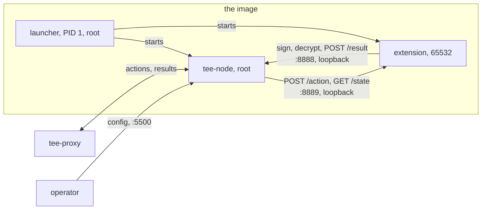
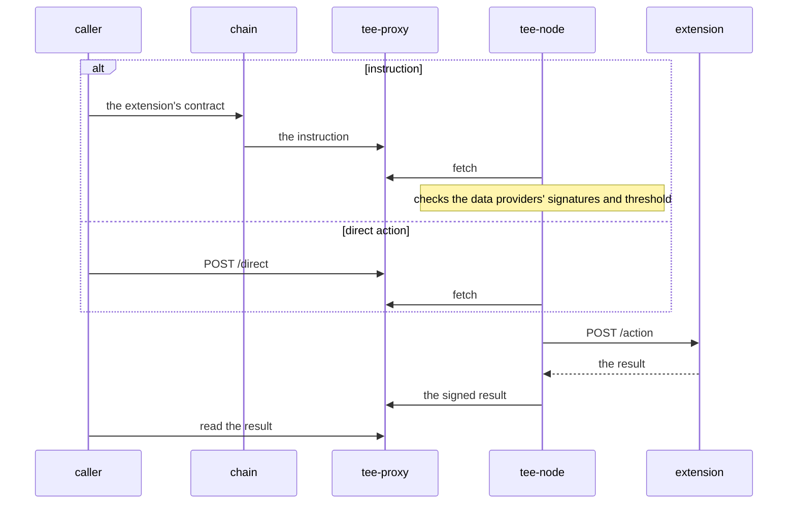
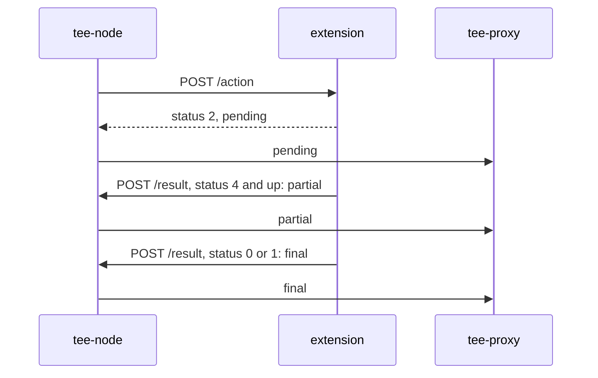

# Architecture

An extension runs in one image inside a TEE: tee-node and the extension, side by side.
tee-node holds the TEE's key, talks to the outside, and signs every result; the extension holds the application's logic.
The rules each side follows are in the [extension contract](extension-contract.md); this page shows how the pieces fit.

## The image

| Process | Runs as | Why |
|---|---|---|
| the launcher | root, PID 1 | it starts the two others under different users |
| tee-node | root | Confidential Space's attestation socket is root-only |
| the extension | a non-root user (65532 in the template), no supplementary groups, no capabilities | it never needs the attestation socket or tee-node's memory |

Both children run with `no_new_privs`, so no program they start gains privileges.
The launcher gives tee-node its whole environment, and the extension only `EXTENSION_PORT`, `SIGN_PORT`, `LOG_LEVEL`, `CHAIN_ID`, `EXTENSION_ID` and the names its `--env` lists.
When either child exits, the launcher stops the other and exits non-zero; on SIGTERM it stops both and exits 0 once both obey.
Confidential Space then reboots the VM or not, by its restart policy; either way the next tee-node has a new key and a new TEE identity.

The extension's user can be set at all because Confidential Space starts the container with `CAP_SETUID` and `CAP_SETGID`.
That is checked in its launcher's source, not yet on a production machine.

## Ports

| Port | Listens | Reachable | For |
|---|---|---|---|
| 5500 | tee-node | from outside | configuring tee-node |
| `SIGN_PORT`, 8888 | tee-node | loopback only | the extension's calls: sign or decrypt with the TEE's key or a wallet key it holds, post a result |
| `EXTENSION_PORT`, 8889 | the extension | loopback only | tee-node's calls: `POST /action`, `GET /state` |

tee-node reads its settings from the environment at start: the proxy URL, the initial owner, the extension ID, the chain ID and the governance.
The operator sets them through the launch policy, which lists the variables an operator may set.
Whoever reaches port 5500 can set the proxy URL at any time, and each of the others once, if the launch policy left it unset.
Until the proxy URL is set, tee-node fetches nothing.

## Two ways in

tee-node pulls actions from tee-proxy's queues, calls the extension, signs the result, and posts it back to tee-proxy, where the caller reads it.

| | Instruction | Direct action |
|---|---|---|
| starts at | the extension's contract, which pays the fee | tee-proxy's `POST /direct`, if its operator enables it |
| checked by tee-node | the data providers' signatures and threshold | only that its op type isn't a system one, `F_` |
| who may send it | anyone the contract lets through | anyone holding tee-proxy's API key, or anyone if the key is optional: the extension authorizes it |
| reaches the extension as | `instruction`, tag `threshold` | `direct`, tag `submit` |

## A result's life

An answer to `POST /action` must arrive within 2 s.
Work that takes longer answers at once with status 2, pending, and posts the rest through the sign port's `POST /result`, which tee-node signs and forwards.

tee-proxy keeps the highest status for each action, and a final result is never replaced.
A restart in between leaves the action pending forever, so callers time out.
The statuses and what tee-node signs are in the [extension contract](extension-contract.md#statuses).
